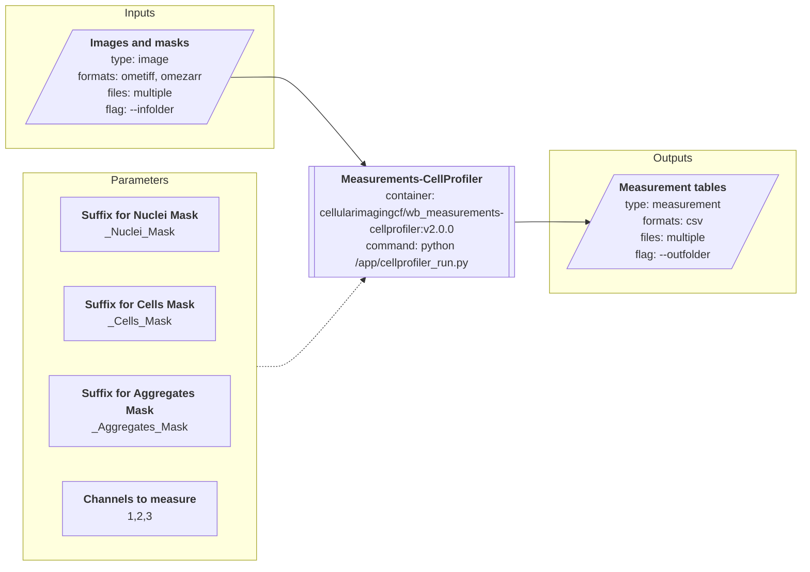

# vis-workflow
Workflow visualiser: shows a bioimage workflow descriptor - [Bilayers](https://bilayers.org/understanding-config/)
`config.yaml`, BIAFLOWS `descriptor.json` or [biomero-schema](https://github.com/NL-BioImaging/biomero-schema)
JSON - as a Mermaid diagram of its inputs, parameters and outputs.



## Web portal
Open a descriptor URL at `https://nl-bioimaging.github.io/vis-workflow/?source=<url>` - a file, or a GitHub
repository or folder. It runs entirely in the browser (Pyodide + Mermaid); `vis-workflow view <file>` shows a local
file in it.

Preview locally:
```bash
python web/build.py                       # wheels for Pyodide into web/wheels/
python -m http.server -d web 8001         # then open http://127.0.0.1:8001/?source=<url>
vis-workflow view config.yaml --portal http://127.0.0.1:8001/
```

## Install
```bash
pip install -e .[test]
```

## Usage
```bash
# SOURCE: a descriptor file, a directory/repository with descriptor.json, descriptor.yaml or config.yaml, or a URL
vis-workflow mermaid https://github.com/Cellular-Imaging-Amsterdam-UMC/cideconvolve
vis-workflow mermaid config.yaml --params all -o diagram.md   # .md gets a mermaid code block
vis-workflow convert config.yaml -o descriptor.json           # biomero-schema JSON
vis-workflow view config.yaml                                 # open in the web portal
```

From Python:
```python
from vis_workflow import load_descriptor, to_mermaid

descriptor = load_descriptor(open("config.yaml", encoding="utf-8").read())
print(to_mermaid(descriptor, params="all"))
```

Parameter modes: `all` (default; Basic and Advanced boxes, each split by Bilayers section), `beginner` (advanced
ones summarised in one node), `grouped` (by Bilayers section only), `collapsed` (one summary node), `none`.

Design and plans: [notes/design.md](notes/design.md), [notes/todo_known_issues.md](notes/todo_known_issues.md).
