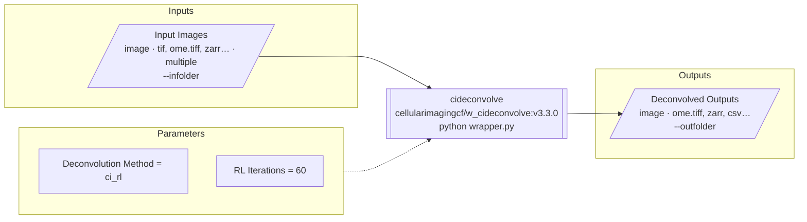

# vis-workflow design

Visualise bioimage workflow descriptors - Bilayers `config.yaml` first, also BIAFLOWS descriptors and native
biomero-schema JSON - as a diagram of the tool's inputs, parameters and outputs.

## Goals
- **Public web portal (essential)**: a static page that takes a descriptor URL, like the
  [ome-ngff-validator](https://ome.github.io/ome-ngff-validator/): `https://<user>.github.io/vis-workflow/?source=<url>`.
- **Local CLI**: `vis-workflow view <file|url>`, like
  [`ome-zarr view`](https://ome-zarr.readthedocs.io/en/stable/basic/cli_basics.html): serve a local file and open the
  hosted portal on it.
- **Main output: a Mermaid diagram** - renders in the portal, and as text pastes into GitHub READMEs/PRs, which
  render Mermaid natively.

## Descriptor parsing: biomero-schema
- Normalised model: `biomero_schema.models.WorkflowSchema` (pydantic).
- Reader: `biomero_schema.adapters.parse_descriptor(data)` auto-detects the format (Bilayers, BIAFLOWS, native)
  and converts.
- Use the NL-BioImaging fork (active: PyPI releases, docs), not BioImageTools/biomero-schema.
- Until [PR #8](https://github.com/NL-BioImaging/biomero-schema/pull/8) is released, depend on its branch:
  `biomero-schema @ git+https://github.com/NL-BioImaging/biomero-schema@feature/bilayers-adapter`.
- Why not a TypeScript port: one parser shared with BIOMERO, no second copy to keep in sync.
- `parse_descriptor` merges Bilayers parameters into `inputs`: split them again by type (image/file/array/
  measurement/executable are data, everything else a parameter).
- Fields not in `WorkflowSchema` that the diagram uses (image tag, `section_id`) are read from the raw descriptor.

## Diagram (Mermaid)
`to_mermaid(workflow, options) -> str`, flowchart left-to-right:



- Data nodes: label, type, formats (truncated), file count, CLI flag. Tool node: name, image (+tag from raw
  descriptor), command.
- Parameters are many (cideconvolve: 41), so modes: `beginner` (default; `mode: advanced` summarised as one
  "+N advanced parameters" node), `all`, `grouped` (by `section_id`, from raw), `collapsed` (one "N parameters"
  node), `none`.
- Parameter layout: a subgraph linked as a whole (`parameters -.-> tool`) is laid out on its own, top-down, which
  puts unlinked nodes in one wide row. So the subgraph sets `direction LR` and rows are chained with invisible
  links (`~~~`) into a grid: one column up to 7 parameters, at most 4 columns.
- Node ids from sanitised descriptor ids; labels escaped/quoted (`#quot;`, `#lt;`, `#gt;`, `#35;`, `#96;`).
- Checked by rendering every fixture in every mode with mermaid-cli 11.

## Web portal
- Static site on GitHub Pages; no server.
- `?source=<url>`: GitHub `blob/` and `tree/` URLs rewritten to `raw.githubusercontent.com`; a repo/tree URL
  auto-discovers `descriptor.json` -> `descriptor.yaml` -> `config.yaml` (BIOMERO's order). Fetched in JS; clear
  message when a host blocks CORS.
- Python via **Pyodide** runs the same package: `candidate_urls`, `load_descriptor`, `to_mermaid`; JS only
  fetches and renders. Pyodide provides pydantic and pyyaml; `web/build.py` builds wheels of vis-workflow and
  biomero-schema (requirement taken from pyproject), installed with micropip `deps=False`. Trade-off: a few seconds
  of first load, for one shared code path.
- Pinned: Pyodide 314.0.7 (Python 3.14, so CI also tests 3.14), mermaid 11.17.2 (same major as the mermaid-cli used
  to check rendering).
- Mermaid `securityLevel: "strict"`: descriptor text comes from arbitrary URLs.
- Page: URL box + example links, parameter mode, copy Mermaid, download SVG, details panel (name, description,
  format, container, command, citations with DOI links, descriptor URL), errors with a CORS hint. `?source=` and
  `?params=` kept in the address for sharing. Light/dark from the system.
- Diagram rendered at natural size; "Fit to width" (default on) scales it with CSS for the overview, off shows
  readable labels with horizontal scroll. Scaling alone made large workflows unreadable; natural size alone hid
  the tool and outputs off-screen.
- Deployed by `.github/workflows/pages.yml` (Pages source must be "GitHub Actions" in the repository settings).

## Python CLI
Reuses click and the standard library (urllib, http.server, webbrowser); no other dependencies.
- SOURCE: a file, a directory (descriptor discovery), or a URL. `sources.candidate_urls()` maps GitHub
  blob/tree/repository URLs to raw URLs (a repository uses `HEAD`); other URLs are fetched as given. It does no I/O,
  so the portal can reuse it.
- `vis-workflow mermaid SOURCE [--params MODE] [-o out.md]`: a `.md` output gets a mermaid code block.
- `vis-workflow convert SOURCE [-o out.json]`: biomero-schema JSON (`biomero-schema parse --json` does the same
  for local files).
- `vis-workflow view SOURCE`: a URL opens the portal directly; a local file is served on 127.0.0.1 and the portal
  opened on it. The server serves only that file (CORS `*` would otherwise let any site read its directory), with
  `Access-Control-Allow-Private-Network` for Chrome's Private Network Access.

## Layout
```
src/vis_workflow/   loader (raw + parsed), mermaid.py, sources.py (URL rewriting), cli.py
web/                index.html, app.js (fetch, Pyodide loader, mermaid render), examples
tests/fixtures/     cideconvolve config.yaml, bilayers_example.yaml, BIAFLOWS descriptor, example_workflow.json
.github/workflows/  tests, Pages deploy
```

## Decisions
| Decision | Reason |
|---|---|
| biomero-schema for parsing | one parser shared with BIOMERO; Bilayers support maintained there |
| Mermaid over custom SVG/ELK | fixed topology; text output reusable in GitHub markdown |
| Pyodide over TS port | single source of truth; load time acceptable for a viewer |
| Static Pages + `?source=` | same model as ome-ngff-validator; no hosting, shareable links |
| Single tool per diagram (v1) | all three formats describe one tool; multi-step pipelines later |
