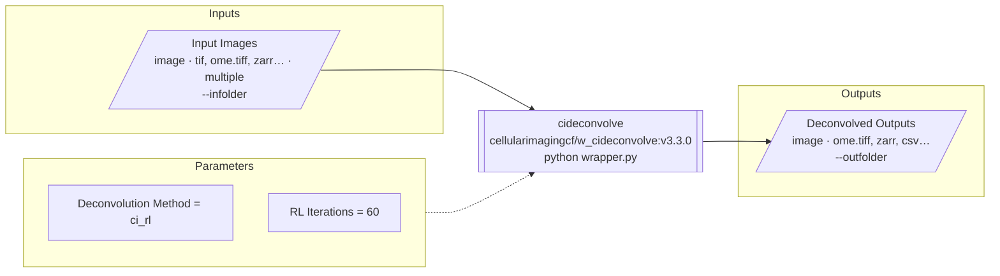

# vis-workflow design

Visualise bioimage workflow descriptors - Bilayers `config.yaml` first, also BIAFLOWS descriptors and native
biomero-schema JSON - as a diagram of the tool's inputs, parameters and outputs.

## Goals
- **Public web portal (essential)**: a static page that takes a descriptor URL, like the
  [ome-ngff-validator](https://ome.github.io/ome-ngff-validator/): `https://<user>.github.io/vis-workflow/?source=<url>`.
- **Local CLI**: `vis-workflow view <file|url>`, like
  [`ome-zarr view`](https://ome-zarr.readthedocs.io/en/stable/basic/cli_basics.html): serve a local file and open the
  hosted portal on it.
- **Main output: a Mermaid diagram** - renders in the portal, and as text pastes into GitHub READMEs/PRs, which
  render Mermaid natively.

## Descriptor parsing: biomero-schema
- Normalised model: `biomero_schema.models.WorkflowSchema` (pydantic).
- Reader: `biomero_schema.adapters.parse_descriptor(data)` auto-detects the format (Bilayers, BIAFLOWS, native)
  and converts.
- Use the NL-BioImaging fork (active: PyPI releases, docs), not BioImageTools/biomero-schema.
- Until [PR #8](https://github.com/NL-BioImaging/biomero-schema/pull/8) is released, depend on its branch:
  `biomero-schema @ git+https://github.com/NL-BioImaging/biomero-schema@feature/bilayers-adapter`.
- Why not a TypeScript port: one parser shared with BIOMERO, no second copy to keep in sync.
- `parse_descriptor` merges Bilayers parameters into `inputs`: split them again by type (image/file/array/
  measurement/executable are data, everything else a parameter).
- Fields not in `WorkflowSchema` that the diagram uses (image tag, `section_id`) are read from the raw descriptor.

## Diagram (Mermaid)
`to_mermaid(workflow, options) -> str`, flowchart left-to-right:



- Data nodes: label, type, formats (truncated), file count, CLI flag. Tool node: name, image (+tag from raw
  descriptor), command.
- Parameters are many (cideconvolve: ~40), so options: `collapsed` (one "N parameters" node), `beginner`
  (hide `mode: advanced`), `grouped` (by `section_id`, from raw), `all`.
- Node ids from sanitised descriptor ids; labels escaped/quoted.

## Web portal
- Static site on GitHub Pages; no server.
- `?source=<url>`: GitHub `blob/` and `tree/` URLs rewritten to `raw.githubusercontent.com`; a repo/tree URL
  auto-discovers `descriptor.json` -> `descriptor.yaml` -> `config.yaml` (BIOMERO's order). Fetched in JS; clear
  message when a host blocks CORS.
- Python via **Pyodide** (pydantic and pyyaml available) runs the same package: `parse_descriptor` + `to_mermaid`;
  mermaid.js renders. Trade-off: a few seconds of first load, for one shared code path.
- Page: URL box + example links, diagram with option toggles, SVG/PNG download, copy Mermaid source, details panel
  (citations, container, flags), parse warnings/errors.

## Python CLI
- `vis-workflow mermaid <file|url> [-o out.md] [--params collapsed|beginner|grouped|all]`
- `vis-workflow view <file|url>`: serve the file with CORS on localhost, open the portal with `?source=`.
- `vis-workflow convert <file|url>`: normalised biomero-schema JSON (also `biomero-schema parse --json`).

## Layout
```
src/vis_workflow/   loader (raw + parsed), mermaid.py, sources.py (URL rewriting), cli.py
web/                index.html, app.js (fetch, Pyodide loader, mermaid render), examples
tests/fixtures/     cideconvolve config.yaml, bilayers_example.yaml, BIAFLOWS descriptor, example_workflow.json
.github/workflows/  tests, Pages deploy
```

## Decisions
| Decision | Reason |
|---|---|
| biomero-schema for parsing | one parser shared with BIOMERO; Bilayers support maintained there |
| Mermaid over custom SVG/ELK | fixed topology; text output reusable in GitHub markdown |
| Pyodide over TS port | single source of truth; load time acceptable for a viewer |
| Static Pages + `?source=` | same model as ome-ngff-validator; no hosting, shareable links |
| Single tool per diagram (v1) | all three formats describe one tool; multi-step pipelines later |
